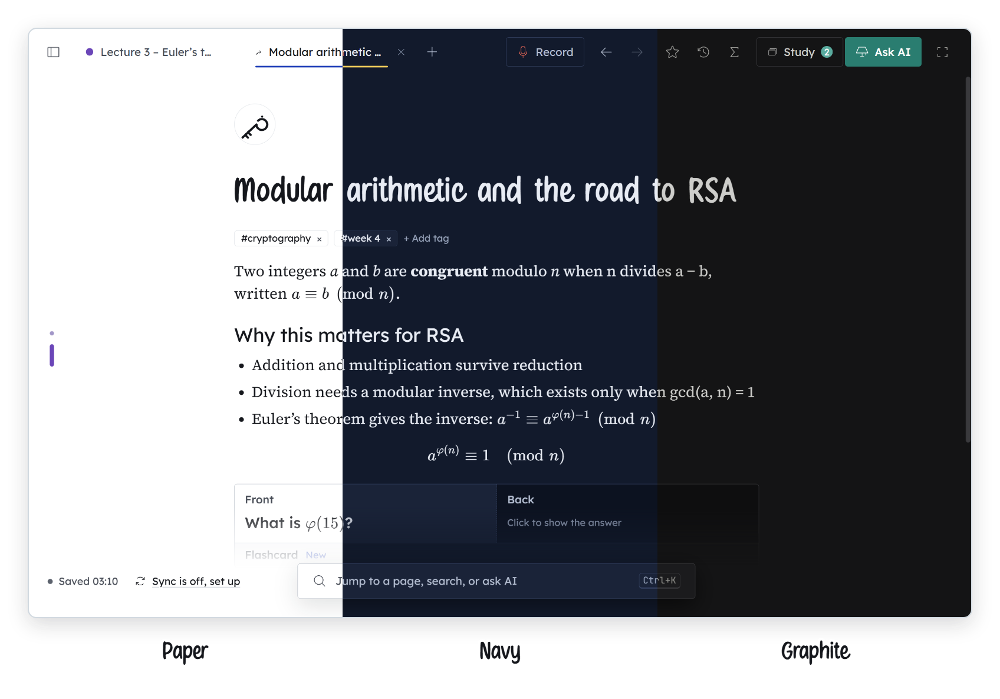
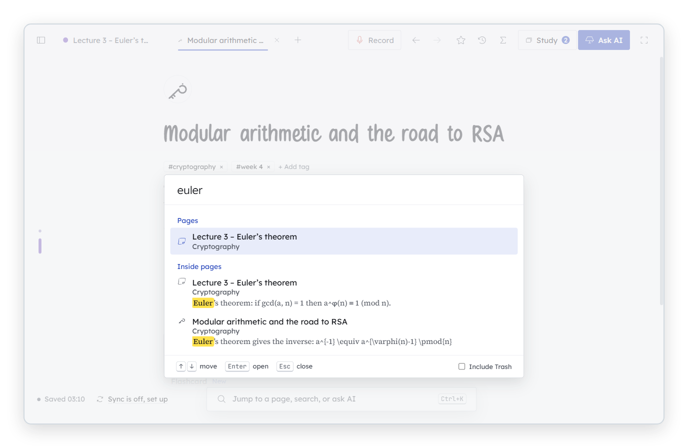
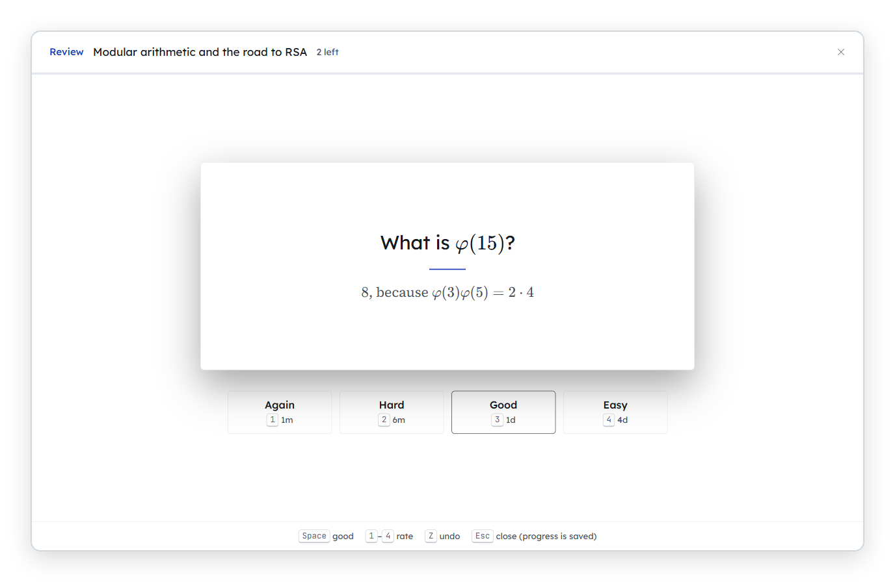

  

<h1 align="center">Daftari</h1>

  A free notes app for students, with AI built in. 
  Record a lecture, get the notes, revise from them.

  <a href="https://github.com/MominEL/Daftari/releases/latest/download/Daftari-Windows-Setup.exe"><picture><source media="(prefers-color-scheme: dark)" srcset="img/readme-btn-windows-dark.png"></picture></a>
  &nbsp;
  <a href="https://github.com/MominEL/Daftari/releases/latest/download/Daftari-Mac-AppleSilicon.dmg"><picture><source media="(prefers-color-scheme: dark)" srcset="img/readme-btn-mac-dark.png"></picture></a>
  &nbsp;
  <a href="https://mominel.github.io/Daftari/"><picture><source media="(prefers-color-scheme: dark)" srcset="img/readme-btn-website-dark.png"></picture></a>

Free · Windows 10 and 11 · Macs with Apple silicon (M1 or newer)

 

  <picture><source media="(prefers-color-scheme: dark)" srcset="img/looks-dark.png"></picture>

Three looks, Paper, Navy and Graphite, each in light, dark and dim. Change it any time in Settings → Appearance.

## How it works

1. **Press record.** Your microphone, your computer’s own sound (a Teams call, an online lecture), or both. The audio is saved every 30 seconds, so a flat battery loses very little.
2. **Read along.** Speech-to-text runs on your own computer, so the lecture is never sent anywhere to be transcribed.
3. **Notes appear as you go.** About every ten minutes the AI writes notes for that part: headings, definitions, formulas. When you stop, you read the finished page before anything is saved.
4. **Revise from the same page.** Turn notes into flashcards or a quiz. Spaced repetition shows each card just before you’d forget it.
5. **Everything stays as plain files.** One file per page, in a folder you choose: on your computer, or in OneDrive, iCloud Drive, Google Drive or Dropbox.

## Find and revise

  <picture><source media="(prefers-color-scheme: dark)" srcset="img/readme-search-dark.png"></picture>

Ctrl+K searches every word in every page, and jumps straight to it.

  <picture><source media="(prefers-color-scheme: dark)" srcset="img/readme-study-dark.png"></picture>

Flashcards made from your notes, shown just before you’d forget them.

## Opening it the first time

Daftari isn’t registered with Microsoft or Apple, so your computer warns you once. That’s expected; only continue if you downloaded it from this page or the website.

- **Windows:** run the installer. If “Windows protected your PC” appears, click **More info**, then **Run anyway**.
- **Mac:** drag Daftari into Applications and open it from there. When macOS says it can’t check it, click **Done**, then go to **System Settings → Privacy & Security** and click **Open Anyway**.

## The AI uses your own key

Daftari comes with no AI key. You use your own, from the company you choose ([Gemini](https://ai.google.dev/gemini-api/docs/api-key) and [Groq](https://console.groq.com/docs/rate-limits) have free plans; [Ollama](https://ollama.com/download) runs on your own computer). The first-time setup walks you through it, and the key is stored encrypted on your computer.

## Your data

- Your notes stay in your folder. Lecture audio stays in Daftari’s own folder and is never synced.
- No accounts, no analytics, no advertising.
- The check for a new version can be switched off in Settings → About.

## Bugs and ideas

Open an [issue](https://github.com/MominEL/Daftari/issues). For security problems, see [SECURITY.md](SECURITY.md).

---

Made by Momin. © 2026. The source code is not public. To check a download’s SHA-256, compare it with <code>SHA256SUMS.txt</code> in the <a href="https://github.com/MominEL/Daftari/releases/latest">latest release</a>; the steps are on the <a href="https://mominel.github.io/Daftari/#download">website</a>.
