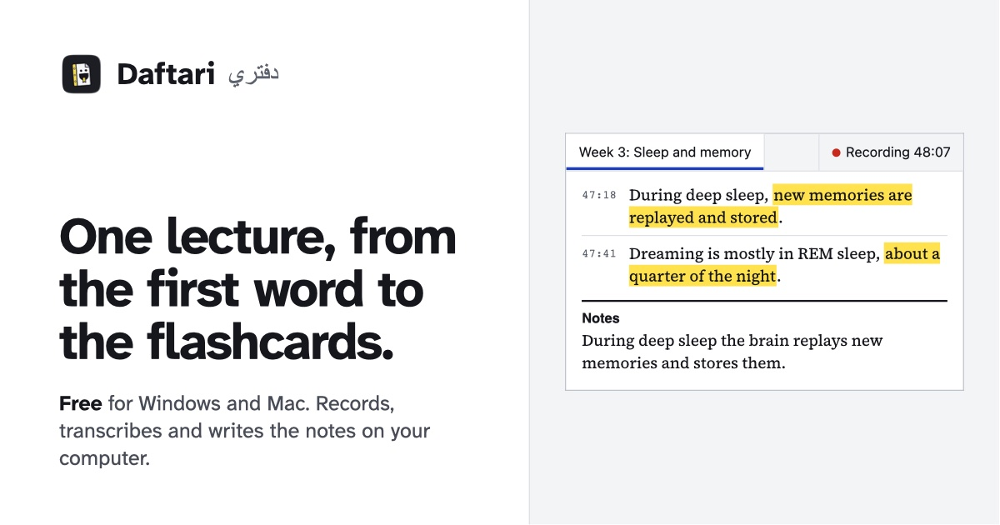
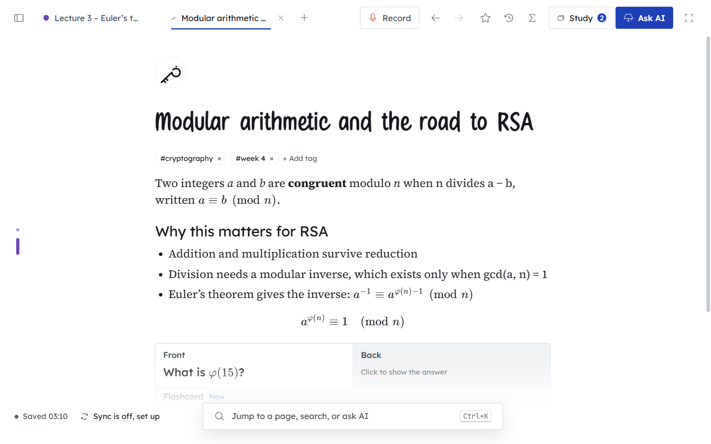
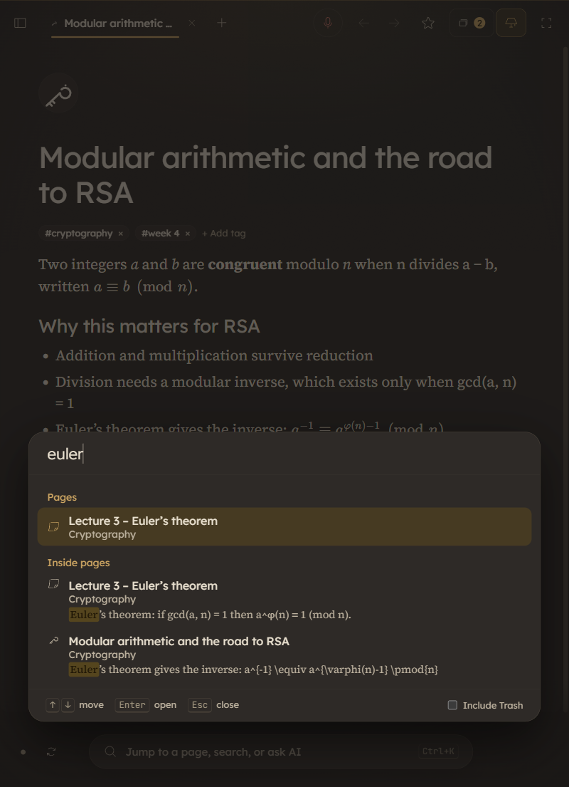
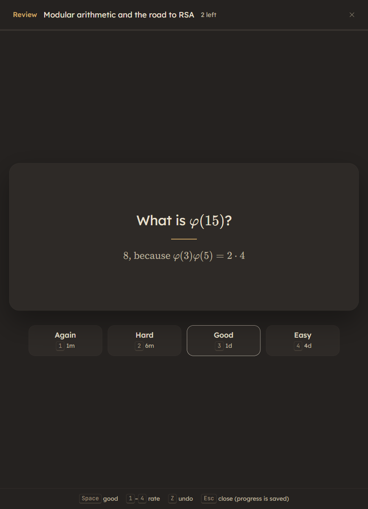

  

<h3 align="center">Record a lecture. Get the notes. Study from them.</h3>

  Daftari is a free notebook for university lectures: it records the lecture, turns the speech into text <b>on your own computer</b>, 
  and writes structured notes you can edit, search and revise from.

  <a href="https://mominel.github.io/Daftari/"><b>Download Daftari</b></a>
  &nbsp;·&nbsp;
  <a href="https://github.com/MominEL/Daftari/releases/latest">Latest release</a>
  &nbsp;·&nbsp;
  <a href="https://github.com/MominEL/Daftari/issues">Report a problem</a>

Windows 10/11 &nbsp;·&nbsp; Mac with Apple silicon (M1 or newer) &nbsp;·&nbsp; Made by Momin

 

<table>
  <tr>
    <td align="center" width="33%"></td>
    <td align="center" width="33%"></td>
    <td align="center" width="33%"></td>
  </tr>
  <tr>
    <td align="center"><b>Notes</b> blocks, nested pages, maths</td>
    <td align="center"><b>Search</b> inside every page</td>
    <td align="center"><b>Study</b> flashcards and quizzes</td>
  </tr>
</table>

## What it does

| | |
|---|---|
| **Records lectures** | From your microphone, from the sound your computer plays (online lectures, Teams), or both. Saved to disk every 30 seconds, so a crash or a flat battery loses almost nothing. |
| **Writes the notes** | Speech-to-text runs **on your computer** (Whisper). Then an AI of your choice turns it into structured notes: key points, definitions, a summary. You see a preview before anything is saved. |
| **Study tools** | Flashcards with spaced repetition and quizzes (multiple choice, true/false, fill in the blank, short answer), made by hand or by the AI from any page. |
| **A proper editor** | Headings, lists, to-dos, tables, code, quotes, toggles, images, PDFs, drag and drop, and a `/` menu. Maths in LaTeX with a symbol keyboard and typing shortcuts. |
| **Finds everything** | One search across the text inside every page, with the words highlighted when you open the result. |
| **Yours to keep** | Pages are plain files in a folder you choose. Put it in OneDrive, iCloud or Dropbox, or sync with your own private GitHub repository. Export everything as Markdown whenever you like. |

## Download

### **[Download from the website →](https://mominel.github.io/Daftari/)**

It has the buttons, install help and checksums. Or take the file straight from the **[latest release](https://github.com/MominEL/Daftari/releases/latest)**:

| System | File |
|---|---|
| Windows 10 or 11 (64-bit) | `Daftari-Windows-Setup.exe` |
| Mac with Apple silicon (M1 or newer), macOS 12 or later | `Daftari-Mac-AppleSilicon.dmg` |

Intel Macs and Linux are coming. You need about 400 MB of disk, plus 150 MB to 1.6 GB for the optional speech-to-text model. On a Mac, speech-to-text uses Homebrew; Daftari shows you the two Terminal commands to copy.

## The first time you open it

Daftari is free and made by one person, so it is not registered with Microsoft or Apple, and both warn you once. That is expected.

<table>
<tr>
<td valign="top" width="50%">

**Windows**

1. Run the installer.
2. If "Windows protected your PC" appears, click **More info**, then **Run anyway**.

</td>
<td valign="top" width="50%">

**Mac**

1. Open the downloaded file and drag Daftari into **Applications**.
2. Open it **from Applications**. macOS says it cannot verify it. Click **Done**, not the highlighted "Move to Bin".
3. Go to **System Settings → Privacy & Security**, scroll down and click **Open Anyway**, then enter your Mac password.

</td>
</tr>
</table>

Only do this for a file you downloaded from this page or the website. The website has the steps with more detail.

## Check what you downloaded

Every release lists a SHA-256 checksum for each file (`SHA256SUMS.txt`). Yours must match exactly.

- **Windows (PowerShell):** `Get-FileHash .\Daftari-Windows-Setup.exe -Algorithm SHA256`
- **Mac (Terminal):** `shasum -a 256 Daftari-Mac-AppleSilicon.dmg`

## Privacy

| | |
|---|---|
| **Your notes** | Stay in a folder on your computer. Nothing is uploaded unless you choose a cloud folder or turn on sync with your own GitHub repository. |
| **Lecture audio** | Never leaves your computer and is never synced. It is transcribed on your computer. |
| **The AI** | Optional. You bring your own key (stored encrypted on your computer). The text you ask about goes to the AI service you choose, and nowhere else. |
| **Tracking** | None: no accounts, no analytics. A little after it starts, Daftari checks this repository for a newer version (turn that off in Settings → About). |

## Updates

- **Windows:** Daftari downloads new versions quietly and installs them when you close it.
- **Mac:** Daftari tells you a new version is ready and opens the download page. Download it and drag it over the old one.

## Problems and ideas

Open an [issue](https://github.com/MominEL/Daftari/issues) and say what you did, what happened, and your Daftari version (Settings → About). Settings → About also has **Report a problem**, which shows exactly what would be copied (no notes, titles or keys) before you share it.

**A security problem?** Please report it privately instead: **Security** tab → **Report a vulnerability**. See [SECURITY.md](SECURITY.md).

---

The source code is not public. © 2026 Momin. All rights reserved. Daftari is built with open-source software, fonts and icons; their licences are listed in the app under Settings → About.

